# General Unreal Engine Pattern Finding Guide

## Used tools
* [x64dbg](https://x64dbg.com/)
* Nukem's [SwissArmyKnife](https://github.com/Nukem9/SwissArmyKnife) plugin for **x64dbg**

## Steps

### 1. Open games `Shipping` exe with **x64dbg**  
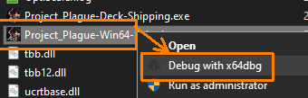

### 2. Open module view
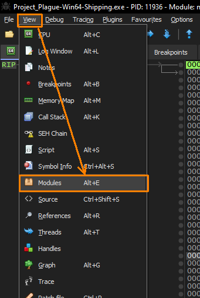

### 3. Select games exe from list (double click it)
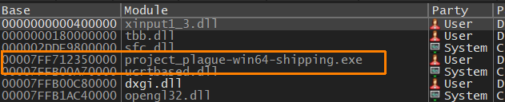

### 4. Finding IsNvidia() method
Open search pattern window  
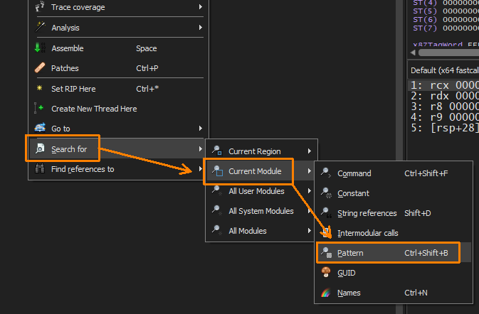

Paste `81 3D ?? ?? ?? ?? DE 10 00 00` and search
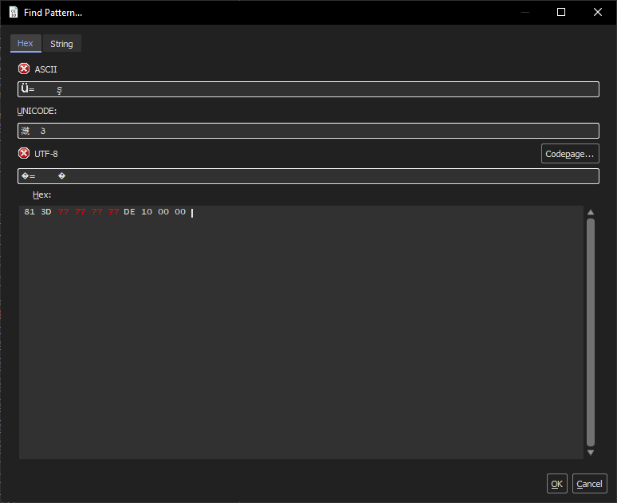

Check results for the find correct method  
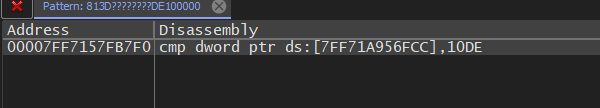

Correct method looks like this  
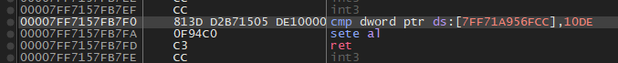

### 5. Finding the location of DLSS plugin call
Find the callers of this method first  
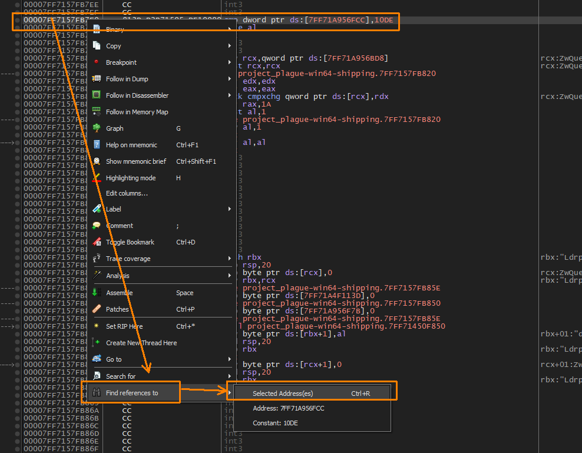

Now boring part, we will check all these referances one by one  
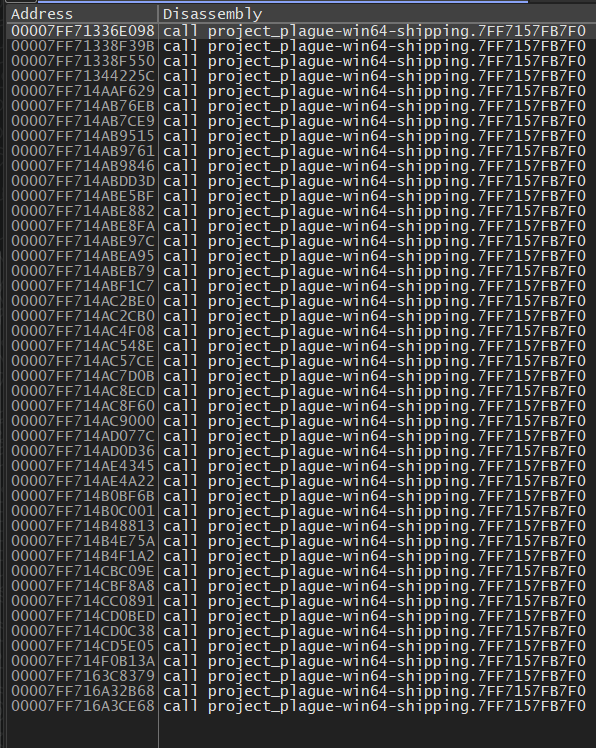

Correct calling point is not so hard to understand. Usually have a message like this just below  
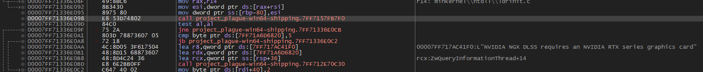

And usually one page above mention of ThirdParty plugins like this  
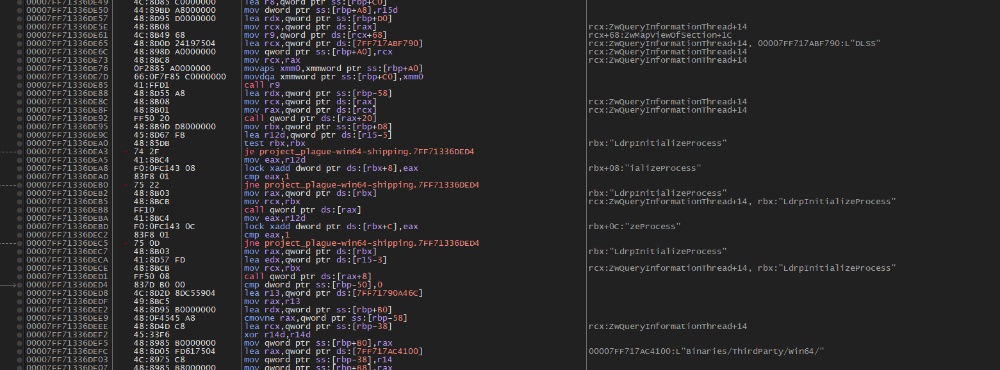

### 6. Generating the pattern
Select from 6-7 lines above call to jump after call like below  
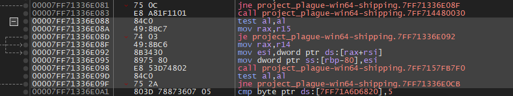

Use **SwissArmyKnife** to generate pattern  
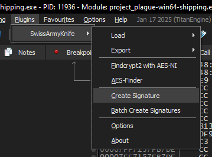

Select **IDA** style  
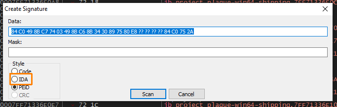

### 7. Finding the offset
I usually truncate last byte so final pattern will be like this.  
`84 C0 49 8B C7 74 03 49 8B C6 8B 34 30 89 75 80 E8 ? ? ? ? 84 C0 75`

We will patch the `84 C0` part so need to find offset of that.
```
00: 84 C0 49 8B C7 74 03 49 8B C6
10: 8B 34 30 89 75 80 E8 ?  ?  ?
20: ?  84 C0 75
       ^ 21th byte
```
Looks like it's 21th byte in pattern.

### 8. Generating code for patch
According to all the info we collected new if condution will be like below.   
**Exe name should be written in all lower case!**

```c++
    // WUCHANG: Fallen Feathers
    else if (exeName == "project_plague-win64-shipping.exe")
    {
        std::string_view pattern("84 C0 49 8B C7 74 03 49 8B C6 "
                                 "8B 34 30 89 75 80 E8 ? ? ? "
                                 "? 84 C0 75");

        auto patchAddress = (void*) scanner::GetAddress(exeModule, pattern, 21);

        if (patchAddress != nullptr)
        {
            std::vector<BYTE> patch = { 0x0C, 0x01 };
            patcher::PatchAddress(patchAddress, &patch);
            _patchResult = true;
        }
    }
```

### Happy hunting!
